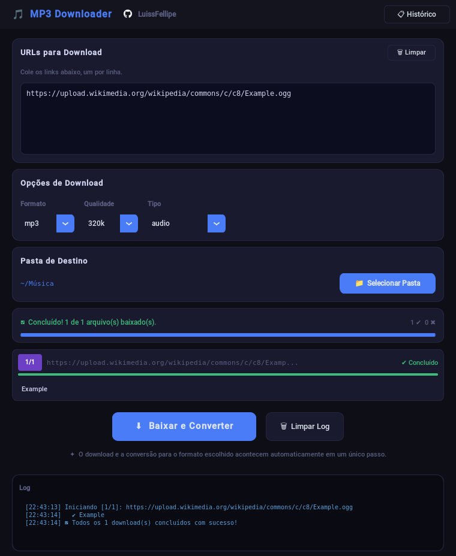

# MP3 Downloader 🎵

Interface gráfica para o [yt-dlp](https://github.com/yt-dlp/yt-dlp): cole um ou vários links, escolha o formato e a pasta, e o programa baixa e converte tudo em sequência, mostrando o andamento de cada item.



## O que faz

- **Áudio** em MP3, M4A ou OGG, com bitrate de 96 a 320 kbps, ou em FLAC e WAV, sem perda.
- **Vídeo** em MP4 ou WebM, juntando a melhor faixa de vídeo com a melhor de áudio.
- **Vários links de uma vez,** um por linha. Linhas repetidas são ignoradas, e cada link tem a própria barra e o próprio status.
- **Histórico** dos downloads, com um botão para reaproveitar um link antigo.
- **Nunca baixa a playlist inteira** por engano: um link de vídeo dentro de uma playlist baixa só aquele vídeo.

## Instalação

Requisitos:
- [Python 3.10+](https://www.python.org/downloads/) com Tkinter;
- [ffmpeg](https://ffmpeg.org/download.html), que o yt-dlp usa para converter o áudio e juntar vídeo com áudio.

```bash
git clone https://github.com/LuissFellipe/mp3-downloader.git
cd mp3-downloader
pip install .            # ou: uv sync
mp3-downloader           # ou: uv run mp3-downloader
```

O ffmpeg vem do gerenciador de pacotes do sistema: `sudo pacman -S ffmpeg` no Arch, `sudo apt install ffmpeg` no Debian e Ubuntu, `winget install ffmpeg` no Windows.

> **Fontes serrilhadas no Linux?** O Python que o `uv` instala vem com um Tk compilado sem Xft, e aí as fontes saem sem suavização e os emojis somem. Use o Python do sistema com o pacote do Tk (`sudo pacman -S tk` no Arch, `sudo apt install python3-tk` no Debian e Ubuntu).

## Como está organizado

```
src/mp3_downloader/
├── app.py         interface (CustomTkinter)
├── downloader.py  monta o comando do yt-dlp e lê o resultado, sem interface
├── historico.py   lê e grava o histórico na pasta de dados do usuário
└── assets/        ícone do GitHub em PNG
tests/             testes do downloader e do histórico (pytest)
```

## Decisões técnicas

- **A lógica fica fora da interface.** O comando do yt-dlp para cada combinação de tipo, formato e qualidade é montado em `downloader.py`, que não importa nada gráfico. Por isso dá para testar tudo sem abrir janela. Os testes cobrem, por exemplo, que FLAC e WAV ignoram o bitrate e que nenhum comando baixa a playlist inteira.
- **A thread de download não mexe na tela.** O Tkinter não é seguro entre threads: um `after()` chamado de fora da thread da interface pode se perder sem erro, dependendo de como o Tcl/Tk foi compilado. Com o Tk 9 do Python 3.12, o download terminava, mas a tela continuava em "Aguardando..." e o botão não voltava. A thread de download agora põe as atualizações numa fila, e a interface as aplica a cada 50 ms.
- **O histórico fica fora do repositório.** Antes, o `download_history.json` ficava ao lado do código, e o histórico real entrou no git. Agora ele vai para a pasta de dados do sistema: `~/.local/share/mp3-downloader/` no Linux, `%APPDATA%\mp3-downloader\` no Windows e `~/Library/Application Support/mp3-downloader/` no macOS. A gravação usa um arquivo temporário e uma troca no fim, para uma falha no meio não deixar o histórico pela metade.
- **Sem dependência nativa para um ícone.** O ícone do GitHub era um SVG convertido em tempo de execução pelo `cairosvg`, que exige a biblioteca Cairo instalada no sistema. Agora é um PNG de 1 KB.
- **Fonte monoespaçada que existe.** A interface pedia Consolas, que não existe no Linux. Agora ela usa a primeira instalada entre JetBrains Mono, Cascadia Mono, Consolas, DejaVu Sans Mono, Liberation Mono e Courier New.

## Testes

```bash
uv run pytest
```

O GitHub Actions roda os testes a cada push. O fluxo completo também foi conferido numa tela virtual (Xvfb): baixar um arquivo de domínio público da Wikimedia, converter para MP3 e ver o status e o histórico atualizarem. É essa a tela da imagem acima.

## Uso responsável

Baixe só conteúdo que você tem o direito de baixar: material seu, em domínio público ou com licença que permita. Os termos de uso do YouTube e de outros sites podem proibir o download fora dos recursos oficiais.

## Licença

[MIT](LICENSE)
